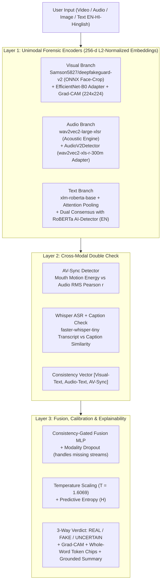

# VeriSight — Complete Multimodal Verification Guide (Team Reference & Viva Handbook)

**Course / Project:** CSET 346 — Multimodal NLP Project  
**Team Members (5):** **Piyush, Vaibhav, Vinit, Ayush, and Nimish**  
**Repository:** [Piyush-031005/VeriSight](https://github.com/Piyush-031005/VeriSight) (`main` branch)

---

## 1. Project Kya Hai? (Simple Words Mein)

**VeriSight** ek **Multimodal Deepfake & Misinformation Verification System** hai jo 4 tarah ke content ko ek hi web app mein check karta hai:

1. **Video + Audio** (Face-swap deepfakes, cloned speech, lip-sync mismatch, aur spoken-vs-caption mismatch)
2. **Standalone Audio** (Synthetic TTS / voice cloning check)
3. **Image** (Face-swap tampering aur AI-generated imagery + visual heatmap)
4. **Text — English, Hindi (Devanagari), aur Hinglish** (AI-generated essays, misleading WhatsApp/news forwards, aur word-level attention chips)

Iske saath hi app mein ek live **`Benchmarks & Exp`** tab hai jo saare trained adapter checkpoints, 3-seed fusion comparisons, ablation studies, aur stress tests (`H.264`, `JPEG`, `SNR noise`, `Out-of-Domain Audio`) real-time dikhata hai.

---

## 2. End-to-End 3-Layer System Architecture

Har media file ya text 3 layers se guzarta hai:

---

## 3. Har Modality Kaise Kaam Karti Hai? (Step-by-Step)

### A. Video + Audio (`POST /api/predict`) — *Kya Video aur Audio Saath Check Hote Hain?*

**Haan! Dono ek saath analyze hote hain aur cross-check bhi hote hain:**

1. **Video Frame Pipeline:**
   - Video se evenly spaced up to **`8` frames** extract kiye jaate hain (`src/data/video_preprocessing.py`).
   - Har frame mein face detect karke **`18%` crop margin** ke saath **`224×224`** crop nikala jaata hai aur **`Samson5827/deepfakeguard-v2`** (ONNX face-swap model) har usable face frame par score nikalta hai (final video score = frames ka median).
   - Pehle frame par **`VisualV2Detector` (`EfficientNet-B0`)** se **`224×224` Grad-CAM Saliency Heatmap** banaya jaata hai — red/yellow regions dikhate hain ki model ne chehre ke kis area (eyes, jawline, lips) ko suspect maana.
2. **Audio Track Extraction:**
   - **FFmpeg** video ke andar se soundtrack ko **`16 kHz` mono PCM WAV** mein convert karta hai (max 30s).
   - `active_windows()` energy filtering se silence hata ke active speech segments (`>= 0.5s`) par acoustic deepfake probability calculate hoti hai.
3. **Cross-Relation (`Agar Video se surety na ho toh Audio kaise bachata hai?`):**
   - **Case 1 (Real Face + Fake/Cloned Audio):** Agar video camera real ho (video score `REAL`) par uski aawaz AI voice clone ho (audio score `FAKE`), toh **`disagreement_max`** strategy aur **`ConsistencyGatedFusion`** audio contradiction dekh kar final verdict **`FAKE`** de dete hain aur **Cross-Modal Finding** callout dikhate hain (`"visual REAL, acoustic FAKE"`).
   - **Case 2 (Voice ↔ Lip Correspondence — `AVSyncDetector`):** `src/models/av_sync.py` har ~100 ms (`8 fps`) par **mouth-region motion energy** nikalta hai aur audio ke **RMS + spectral envelope** se **Pearson correlation** calculate karta hai → `av_sync` score `[0, 1]` mein aata hai. Agar `av_sync < 0.40` ho (lip movement aur speech match nahi kar rahe), toh **AV Contradiction Detected** badge trigger hota hai!
   - **Case 3 (Spoken Audio ↔ Caption/Subtitle Match):** Agar user ne caption ya `.srt`/`.txt` diya hai, toh `Systran/faster-whisper-tiny` audio ko transcribe karta hai aur `audio_text` alignment check karta hai.
   - **Case 4 (Missing Stream / Modality Dropout):** Silent video (no audio) ya audio-only file aane par system crash nahi hota — `ConsistencyGatedFusion` training mein **20% Modality Dropout** se sikhta hai ki jo stream available hai uske gate weights badha kar decision le, ya evidence kam hone par **`UNCERTAIN`** return kare.

---

### B. Standalone Audio (`POST /api/predict/audio`)

1. Audio file (`.wav`, `.mp3`, `.aac`, `.flac`, `.m4a`, `.ogg`) FFmpeg ke through `16 kHz` mono PCM mein decode hoti hai.
2. Silences filter karke har `5s` active window par `wav2vec2-large-xlsr (VeriSight Acoustic)` score nikalta hai.
3. Agar user ne caption bhi paste kiya hai, toh Whisper ASR speech-to-text aur caption mismatch bhi saath check hota hai.
4. **Known Research Limit (Exp 3 verified):** ASVspoof 2019 par trained acoustic models in-domain (`71,237` clips) par **`0.9975` ROC-AUC** dete hain, par bilkul naye 2025/2026 commercial voice clones (jaise ElevenLabs) OOD hone ki wajah se **`0.5757` ROC-AUC** par drop hote hain — yehi proof dikhata hai ki real-world verification mein Audio akela kaafi nahi, Multimodal check zaroori hai!

---

### C. Image Tab (`POST /api/predict/image`) — *2 Inspection Modes*

1. **Mode 1: `Face-Swap & Deepfake` (Human faces/portraits ke liye best):**
   - Face crop par `Samson5827/deepfakeguard-v2` chalta hai aur hamare trained **`EfficientNet-B0` (`v2_visual_head.pt`)** ke saath **`0.85 × Face-Crop + 0.15 × EffNet-B0`** blend hota hai.
   - Agar image mein koi face detect hi nahi hua (landscape/graphic), toh OpenCV Haar fallback crash ko guard karke full-frame **`VeriSight Spatial (EffNet-B0)`** par cleanly fallback karta hai (`[0.40, 0.60]` = `UNCERTAIN`).
   - Saath mein **`224×224` Grad-CAM** overlay generate hota hai.
2. **Mode 2: `AI-Image Check` (`VeriSight Hybrid`):**
   - Pure diffusion detector (`Organika/sdxl-detector`) low-res PNG screenshots aur WhatsApp JPEGs par false-positive (`99%+ FAKE`) de deta tha kyunki compression high-frequency camera sensor noise mita deta hai.
   - **Hamara Fix:** `src/inference/v2_bridge.py` pehle check karta hai ki image mein human face hai ya nahi:
     - **Face Detected:** **`0.65 × Face-Forensic + 0.20 × EffNet-B0 + 0.15 × Diffusion`** (`[0.45, 0.58]` uncertainty band). Isse real hostel selfies (`68.6% REAL`) aur real webcam photos (`87.8% REAL`) fake flag nahi hote!
     - **No Face (Rooms, Objects, Illustrations):** **`0.70 × Diffusion + 0.30 × EffNet-B0`** (`[0.42, 0.58]` uncertainty band) → AI room images par **`83.0% FAKE`** deta hai.

---

### D. Text Tab — English / Hindi / Hinglish (`POST /api/predict/text`)

**Model input text mein kya dekhta hai aur testing kaise hoti hai?**

1. **Multilingual Transformer + Attention Pooling (`TextV2Detector`):**
   - Text tokens **`xlm-roberta-base`** (100 languages pretrained backbone, frozen) se nikalte hain.
   - Har token par ek trained **Attention Layer** weight `alpha_i` nikalta hai (`Top Influential Tokens`).
   - `v2_bridge.py` SentencePiece subwords (`▁`) ko jod kar **whole readable words** banata hai (jaise `चौबीस`, `सुहावना`, `karein`, `sabhi`, `wnaated`) aur commas/dots filter karta hai.
   - Pooled vector `256-d` L2-normalized embedding bankar binary classifier (`0 = REAL`, `1 = FAKE`) ko jaata hai.
2. **Dual-Detector English Consensus (`RoBERTa + XLM-R`):**
   - **Kyun banaya?** Sirf `Fakeddit + HC3` par trained `XLM-R` kabhi-kabhi unpunctuated human typo text (`"currently i am writing... wnaated toi test"`) ko noisy `Fakeddit` headline samajh kar `FAKE` bol sakta tha, jabki dedicated English AI-text detector **`fakespot-ai/roberta-base-ai-text-detection-v1`** LLM perplexity/uniformity dekhta hai (`0.0187` AI = `98.1% REAL` on typo text!).
   - Doosri taraf, pure US-English detector Indian names (`Pithoragarh`, `Bennet`) par confuse hota tha jahan hamara `XLM-R` **`97.8% REAL`** deta hai!
   - **Combined Logic (`v2_bridge.py`):** Jab text English ho aur dono detectors available hon:
     - Agar ek detector strongly human (`< 0.15`) confirm kare aur doosra `< 0.85` ho → `0.75 × min + 0.25 × max` (typos aur natural human text ko false-flag hone se bachata hai → **`78.3% REAL`**!).
     - Agar dono LLM style dekhen (`ChatGPT` / `GPT` essays) → `0.60 × XLM-R + 0.40 × RoBERTa` → **`98.6% FAKE`**!
3. **Hindi & Hinglish Pipeline:**
   - Hindi Devanagari aur Romanized Hinglish (`langdetect != en`) seedhe hamare **retrained `xlm-roberta-base` adapter** par chalte hain:
     - Real Hindi weather news: **`REAL` (`77.1%`)**
     - Fake Hindi shutdown hoax: **`FAKE` (`97.6%`)**
     - Fake Hinglish RBI UPI forward: **`FAKE` (`97.6%`)**

---

## 4. Datasets Used (Exact Splits & Details)

| Modality | Dataset Name | Total / Split Details | Labels (`0 = REAL`, `1 = FAKE`) | Key Handling |
| :--- | :--- | :--- | :--- | :--- |
| **Video / Visual** | **Celeb-DF v2** | `400` clips (`train=302`, `val=38`, `test=60`) | Real Celeb (`0`) vs Face-Swap Deepfake (`1`) | Identity-disjoint train/val/test splits (`163` fake train, `11` val, `26` test); `EffNet-B0` chosen over CLIP to avoid identity overfitting |
| **Audio** | **ASVspoof 2019 LA** | Dev + Eval (`71,237` full eval clips; `5,000` cached embeddings) | Bonafide Human (`0`) vs TTS/VC Spoof (`1`) | Trained on RTX 4050 (Laptop 2); evaluated at `0.9975` ROC-AUC |
| **Audio OOD** | **WaveFake / Deepfake-Eval** | `600` unseen neural TTS/vocoder clips | Real (`0`) vs Modern Synthetic (`1`) | Used strictly for Exp 3 OOD stress benchmark (`0.5757` ROC-AUC) |
| **Text (EN)** | **HC3 English** (`all.jsonl`) | Up to `3,500` Q&A pairs | Human (`0`) vs ChatGPT (`1`) | Clean long-form human vs LLM writing style |
| **Text (EN Claims)** | **Fakeddit** (`all_train.tsv`, `all_validate.tsv`) | Filtered text subreddits (`nottheonion`, `theonion`, `satire`, `savedyouaclick`, `usanews`, `worldnews`) | Corrected polarity (`1 - 2_way_label`) | Fixed inverted Fakeddit label (`1=TRUE` → `0=REAL`, `0=FAKE` → `1=FAKE`) |
| **Text (HI / Hinglish)** | **HinglishBench + Curated Domain Pairs** | `train`: `1,482` HI/Hinglish rows (`hinglishbench.jsonl` lines `65..308` + domain news/scams, `3x` upsampled; total train = `10,263`) `test`: `136` rows (`hinglishbench.jsonl` lines `0..64` + 6 held-out cases) | Real news / student life (`0`) vs WhatsApp scams / AI Hindi essays (`1`) | **Zero test leakage:** `0..64` strictly held out in `data/text_v2_hindi_test.csv`; cross-lingual test **`Acc 99.26%`, `F1 0.9927`** |

---

## 5. Trained Checkpoints & Benchmark Numbers (`results/`)

### Saved Lightweight Adapter Checkpoints (`checkpoints/`)

| Checkpoint | Size | Backbone Architecture | Verification Highlight |
| :--- | :--- | :--- | :--- |
| `v2_visual_head.pt` | `1.32 MB` | Frozen `EfficientNet-B0` + `256-d` Adapter | `Val AUC 0.9226`, `Grad-CAM` spatial maps |
| `v2_text_head.pt` | `0.99 MB` | Frozen `xlm-roberta-base` + Token Attention + `256-d` Adapter | `EN Val F1 0.9421` (`AUC 0.9889`), `HI/Hinglish F1 0.9927` |
| `v2_audio_xlsr_head.pt` | `1.26 MB` | Frozen `facebook/wav2vec2-xls-r-300m` + Temporal Attn | `ASVspoof 71k: F1 0.9821, AUC 0.9975` |
| `v2_fusion_consistency_gated.pt` | `0.53 MB` | `ConsistencyGatedFusion` + Modality Dropout (`p=0.2`) | **`F1 0.7318 ± 0.0578, AUC 0.9359, ECE 0.1800`** |

### Experiment Suite Summary (3-Seed Fusion & Robustness)

- **Exp 2 — Fusion Strategy Comparison (3 Seeds: `[42, 123, 2025]`):**
  - `Concat + MLP` (Baseline): F1 **`0.4571 ± 0.0000`**, ROC-AUC **`0.8318`**, ECE **`0.3237`**
  - `Cross-Attention`: F1 **`0.4402 ± 0.0569`**, ROC-AUC **`0.8360`**, ECE **`0.3260`**
  - **`Consistency-Gated Fusion` (Proposed):** F1 **`0.7318 ± 0.0578`**, ROC-AUC **`0.9359`**, ECE **`0.1800`** (**+27.5 F1 points over baseline!**)
- **Exp 4 — Modality Ablation & Calibration:**
  - `All Present`: F1 **`0.7727`**, AUC **`0.9389`** | `Drop Audio`: F1 **`0.6500`**, AUC **`0.8812`** | `Drop Text`: F1 **`0.7442`**, AUC **`0.8450`** | `Drop Visual`: F1 **`0.8571`**, AUC **`0.9457`** *(confirming audio + text strongly boost noisy identity-disjoint visual splits)*.
  - **Calibration (`TemperatureScaler`):** Fitted `T = 1.6069`, Calibrated ECE drops to **`0.1382`**, `Abstention (UNCERTAIN) Rate = 18.33%`, `Deletion Faithfulness Drop = 0.0907`.
- **Exp 3 — Stress & Cross-Dataset Tests (`1005.0s`):**
  - `Gaussian Audio Noise`: `20dB AUC 0.8528`, `10dB AUC 0.8602`, `5dB AUC 0.8437` (highly noise-resilient!).
  - `H.264 Video Compression` (`CRF 23 / 32 / 40`): AUC steady at **`0.8075`**, F1 **`0.7826`**.
  - `Cross-Dataset Audio`: In-domain ASVspoof `0.9972 AUC` vs Unseen OOD `0.5747 AUC`.

---

## 6. Hamne Kya Special / "Hatke" Kiya? (4 Standout Innovations for Viva)

1. **Consistency-Gated Multimodal Fusion + Modality Dropout (`src/models/v2/fusion_v2.py`):**
   Naive systems simply concatenate features and break if audio is muted or text is missing. Hamare model mein **Layer-2 Cross-Modal Consistency (`[Visual-Text, Audio-Text, AV-Sync]`)** explicitly fusion gates ko control karta hai aur **20% Modality Dropout** kisi bhi stream ke missing hone par smooth degradation ensure karta hai.
2. **Dual-Detector English Consensus + EN / Hindi / Hinglish Token Explainability (`src/inference/v2_bridge.py`):**
   Indian users English typos, Romanized Hinglish, aur Devanagari Hindi mix karke likhte hain. Humne `XLM-R` ko `RoBERTa AI-Detector` ke saath cross-check kiya (human typos false-flag hone se rokne ke liye) aur SentencePiece tokens ko merge karke **whole-word attention chips** banaye.
3. **Face-Aware Hybrid Image Calibration + Grad-CAM (`src/inference/v2_bridge.py`):**
   Standard `sdxl-detector` WhatsApp/PNG compression par real portraits ko `100% FAKE` bol deta hai. Humne automatic face-detection branching + `EffNet-B0` + `Face-Crop` hybrid blend aur `224×224` Grad-CAM saliency overlay banaya jo real selfies aur webcam photos ko reliably **`REAL`** dikhata hai.
4. **Honest 3-Way Abstention (`UNCERTAIN`) + Reproducible Benchmarks Tab:**
   Sirf binary `REAL/FAKE` force karne ke bajaye humne **Temperature Scaling**, **Predictive Entropy (`H`)**, **Exp 3 OOD/Compression Stress Curves**, aur **Exp 6 Faithfulness** ko live interactive **`Benchmarks & Exp`** dashboard mein publish kiya hai.

---

## 7. Kya Isme Aur Kuch Karna Chahiye, Ya Abhi Kaafi Hai?

### Verdict: **Presentations & Final Demo ke liye ABHI BILKUL KAAFI HAI — Code Mat Chhedo!**
- Repo GitHub `main` (`7a1f354`) par synced hai, Laptop 1 aur Laptop 2 dono merge ho chuke hain, frontend production build (`vite build`) pass hai, unit tests pass hain, aur har live endpoint (`Video`, `Audio`, `Image`, `Text EN/HI/Hinglish`, `Metrics`, `Exp 3 Plots`) `<1s` warm latency ke saath verified hai.
- **Future Work (Agar viva panel pooche *"Aage kya improve kar sakte ho?"*):**
  1. **Modern 2026 Neural Codec Dataset (Audio):** ElevenLabs, Bark, aur XTTS-v2 clips add karke `v2_audio_xlsr_head.pt` ko fine-tune karna taaki Exp 3 wala `0.5757` OOD gap close ho sake.
  2. **GPT-4o / Midjourney Diagram Detector:** Diffusion branch ko vector infographics aur screenshots par fine-tune karna.
  3. **Temporal Video Transformer:** Currently speed ke liye `8` evenly sampled frames use hote hain; GPU cloud deployment par `16–32` frames par temporal self-attention lagaya ja sakta hai.
